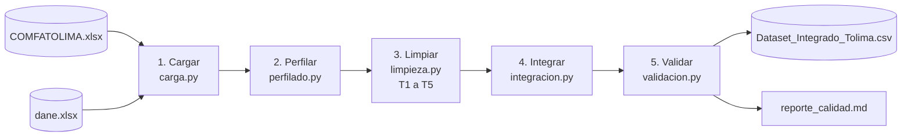

# Análisis de las brechas entre oferta y demanda laboral en el Tolima

**Pipeline reproducible de integración y transformación de datos**

- **Asignatura:** Fundamentos de Integración y Transformación de Datos — Universidad de Ibagué (2026)
- **Docente:** Mariana Millán Meneses
- **Integrantes:** Karen Vanesa Cardona, María Fernanda Rodríguez, Karen Natalia Moreno Bermúdez

> Con un solo comando (`python main.py`) el pipeline lee las fuentes crudas, las diagnostica, las limpia con cinco transformaciones justificadas, las integra en un único dataset, valida el resultado y genera un reporte de calidad.

---

## 1. Problema y objetivo

En el Tolima existe una desconexión entre la información de quienes buscan empleo y las vacantes que demandan los sectores productivos. Los datos están dispersos en fuentes heterogéneas (macrodatos estadísticos del DANE y registros operativos del Servicio Público de Empleo / ComfaTolima), lo que impide ver de forma unificada el contexto del mercado laboral.

**Objetivo del pipeline:** consolidar en un solo dataset limpio y validado las vacantes del Tolima junto con los indicadores laborales del DANE, listo para análisis de brechas entre oferta y demanda.

## 2. Fuentes de datos

| Fuente | Archivo | Qué contiene | Granularidad |
|---|---|---|---|
| Servicio Público de Empleo / ComfaTolima | `COMFATOLIMA.xlsx` | Vacantes publicadas (1.000 filas x 20 columnas en la muestra) | Una fila por vacante, con fecha diaria |
| DANE | `dane.xlsx` (hoja `Hoja1`) | Indicadores del mercado laboral del Tolima (16 filas x 20 columnas): tasas (TGP, TO, TD, TS) y volúmenes de población | Anual, 2007-2025, nivel departamental |

Los archivos originales van en `data/raw/` y **nunca se modifican**. El diccionario de datos completo está en [`docs/diccionario_datos.md`](docs/diccionario_datos.md).

## 3. Arquitectura del pipeline



`main.py` orquesta las etapas en orden. Si una validación crítica falla, el pipeline se detiene y **no exporta** el dataset.

## 4. Diagnóstico de calidad (evidencia inicial)

Resultados del diagnóstico sobre los archivos de muestra (Avance 1):

| Hallazgo | Evidencia |
|---|---|
| Filas duplicadas | 2 filas totalmente duplicadas y 2 códigos de vacante repetidos |
| Cobertura geográfica | Solo 11 de 1.000 ofertas (1,1 %) son del Tolima, con 67 plazas de trabajo |
| Valores atípicos | 164 vacantes con más de 120 meses de experiencia; máximo registrado: 999 meses (código de error del formulario) |
| Salario ambiguo | 186 vacantes (18,6 %) con salario "A Convenir"; el rango salarial es texto, no número |
| Codificación corrupta | Caracteres dañados (mojibake) en títulos, cargos y sectores, y prefijo basura `$hNo Codigo vacante$` |
| DANE en formato matriz | Una fila por indicador y una columna por año, con filas vacías separadoras y unidades mezcladas (% y miles de personas) |

Cada vez que se ejecuta el pipeline, estas mismas métricas se recalculan y se comparan **antes vs. después** en [`outputs/reporte_calidad.md`](outputs/reporte_calidad.md).

## 5. Transformaciones (5) y su justificación

| # | Transformación | Problema que resuelve | Justificación |
|---|---|---|---|
| T1 | **Corrección de codificación** (mojibake) | Textos como `VEHÃ�CULO` o `ingeniería` | Evita que "ALMACÉN" y "ALMACÉN" cuenten como categorías distintas y que fallen las búsquedas por texto |
| T2 | **Desduplicación y tratamiento de outliers** | Vacantes repetidas y experiencias de hasta 999 meses | La clave `CODIGO_VACANTE` debe ser única para no inflar plazas ni duplicar filas al integrar. Los valores > 120 meses pasan a **nulo** (no se inventa un tope: el nulo dice "no informado") |
| T3 | **Estandarización del salario** | `RANGO_SALARIAL` es texto | Se crea `SALARIO_ESTIMADO_NUM` con el punto medio de cada rango (columna nueva; el rango original se conserva). "A Convenir" queda nulo: no hay base para estimarlo |
| T4 | **Normalización (unpivot/melt) del DANE** | Matriz ancha con filas vacías y unidades mezcladas | El formato largo `[CONCEPTO, ANIO, VALOR, TIPO_UNIDAD]` permite filtrar por año (la llave de integración) y deja explícita la unidad de cada indicador |
| T5 | **Segmentación geográfica** | El archivo trae vacantes de todo el país | El objetivo es el Tolima y el DANE es departamental; mezclar otros departamentos daría conclusiones erróneas |

El código de cada transformación está en [`src/limpieza.py`](src/limpieza.py) y su justificación aparece en el docstring de cada función.

## 6. Integración

- **Llave:** el **año**. Las vacantes tienen fecha de publicación diaria y el DANE es anual.
- **Regla:** cada vacante recibe los indicadores del DANE del año de referencia (`ANIO_REFERENCIA_DANE`). Como las vacantes son de 2026 y el DANE llega hasta 2025, se usa **el último año disponible del DANE**. La columna queda en el dataset para que la decisión sea transparente.
- **Tipo de unión:** `LEFT JOIN` muchos-a-uno (vacantes → año). Se conservan todas las vacantes y ninguna fila se duplica (`validate="many_to_one"`).
- **Resultado:** `outputs/Dataset_Integrado_Tolima.csv`, con una fila por vacante del Tolima y columnas `DANE_*` (por ejemplo `DANE_TD` = tasa de desocupación).

## 7. Validaciones

El pipeline ejecuta 20 validaciones y las reporta con estado `OK`, `FALLO` (crítica: detiene el pipeline) o `AVISO`:

- **Vacantes:** `CODIGO_VACANTE` único y sin nulos; `CANTIDAD_VACANTES` sin nulos y > 0; solo departamento Tolima; todos los municipios pertenecen a los 47 del Tolima; sin experiencia > 120 meses; salarios numéricos solo del mapa definido; sin mojibake residual; coherencia temporal (vencimiento ≥ publicación).
- **DANE:** sin nulos en concepto y año; un valor por (concepto, año); tasas dentro de 0-100; volúmenes no negativos; serie anual continua.
- **Integración:** no se pierden ni duplican vacantes; la clave sigue siendo única; toda vacante encontró su año en el DANE; **conciliación**: los indicadores integrados coinciden exactamente con la fuente.

Las pruebas automáticas (`tests/`) incluyen pruebas **negativas**: verifican que las validaciones realmente fallan cuando los datos están mal.

## 8. Cómo ejecutar

### En el computador

```bash
# 1. Clonar el repositorio
git clone https://github.com/karenmoreno1805/NOMBRE-DEL-REPOSITORIO.git
cd NOMBRE-DEL-REPOSITORIO

# 2. (Opcional) crear un entorno virtual
python -m venv .venv
.venv\Scripts\activate          # Windows
# source .venv/bin/activate     # Mac / Linux

# 3. Instalar dependencias
pip install -r requirements.txt

# 4. Verificar que los archivos originales estén en data/raw/
#    COMFATOLIMA.xlsx  y  dane.xlsx

# 5. Ejecutar el pipeline
python main.py
```

### En Google Colab

```python
!git clone https://github.com/karenmoreno1805/NOMBRE-DEL-REPOSITORIO.git
%cd NOMBRE-DEL-REPOSITORIO
!pip install -r requirements.txt
!python main.py
```

### Pruebas automáticas

```bash
python -m unittest discover tests -v
```

### Salidas generadas

| Archivo | Contenido |
|---|---|
| `data/processed/Fact_Vacantes_Tolima_Limpio.csv` | Vacantes del Tolima limpias |
| `data/processed/Fact_Indicadores_DANE_Tolima_Limpio.csv` | Indicadores DANE en formato tidy |
| `outputs/Dataset_Integrado_Tolima.csv` | **Dataset final consolidado** (vacantes + DANE) |
| `outputs/reporte_calidad.md` | Comparación antes vs. después y resultado de las validaciones |

## 9. Estructura del repositorio

```
.
├── data/
│   ├── raw/             # Fuentes originales (COMFATOLIMA.xlsx, dane.xlsx) - no se modifican
│   └── processed/       # Datasets limpios generados por el pipeline
├── docs/                # Informe del Avance 1 y diccionario de datos
├── notebooks/           # Avance 1 y Avance 2 (exploración original en Colab)
├── outputs/             # Dataset integrado y reporte de calidad
├── src/
│   ├── config.py        # Rutas, umbrales y reglas de negocio
│   ├── carga.py         # 1. Cargar
│   ├── perfilado.py     # 2. Perfilar (diagnóstico)
│   ├── limpieza.py      # 3. Limpiar (T1-T5)
│   ├── integracion.py   # 4. Integrar
│   ├── validacion.py    # 5. Validar
│   └── reporte.py       # Reporte de calidad en Markdown
├── tests/               # Pruebas automáticas con datos sintéticos
├── main.py              # Punto de entrada: python main.py
├── requirements.txt
└── README.md
```

## 10. Limitaciones y decisiones de diseño

- **Baja representatividad local:** en el archivo de muestra solo el 1,1 % de las vacantes son del Tolima (11 ofertas), así que los análisis desagregados por municipio son limitados. El pipeline está listo para procesar un archivo más grande sin cambios.
- **Desfase temporal:** el DANE llega hasta 2025 y las vacantes son de 2026; por eso se usa el último año disponible del DANE como referencia (ver sección 6).
- **Salarios estimados:** el punto medio del rango es una aproximación; "Mayor de $15.000.001" se estima con su límite inferior (conservador).
- **Experiencia > 120 meses:** se trata como error de captura y se deja como "no informado".
- **Corrección de codificación:** cuando un byte se perdió por completo (`Ã�`), la letra original es ambigua; se asume `Í`, el caso más frecuente en los datos.
- **Municipios:** la validación usa los 47 municipios del Tolima (ya no una lista fija de 4).

## 11. Historial del proyecto

- **Avance 1** (`notebooks/Avance_1_.ipynb`): definición del problema, extracción inicial, diccionario de datos y diagnóstico de calidad.
- **Avance 2** (`notebooks/Avance_2_.ipynb`): primeras transformaciones y controles de calidad en notebook.
- **Versión final:** el código de los notebooks se reorganizó en el pipeline modular de `src/` y se añadió la integración real de las dos fuentes.
